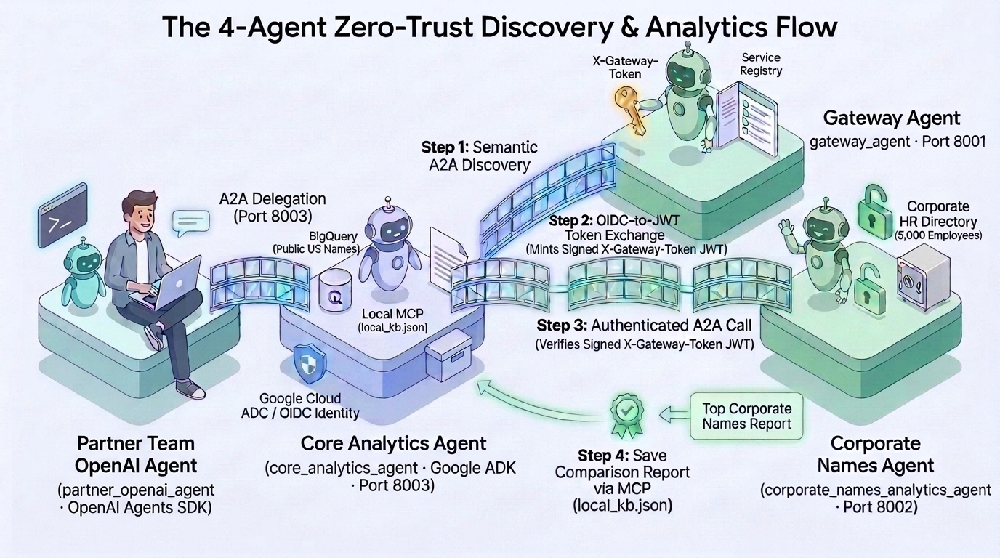
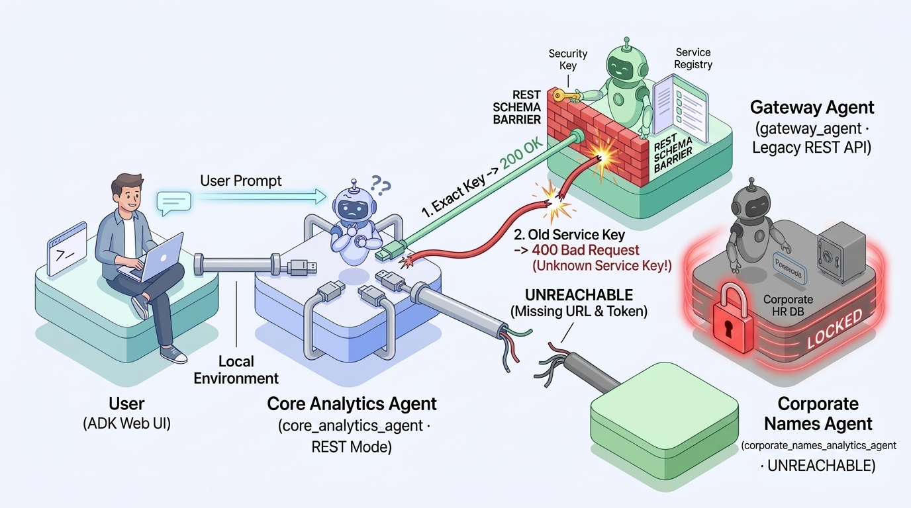
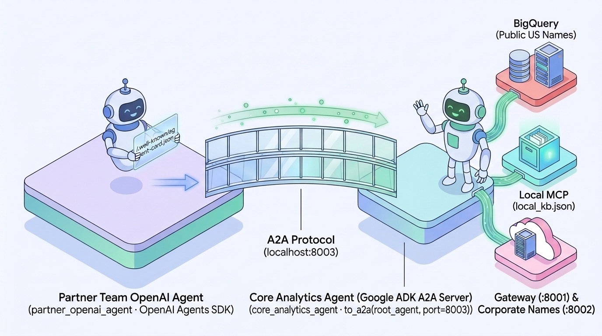
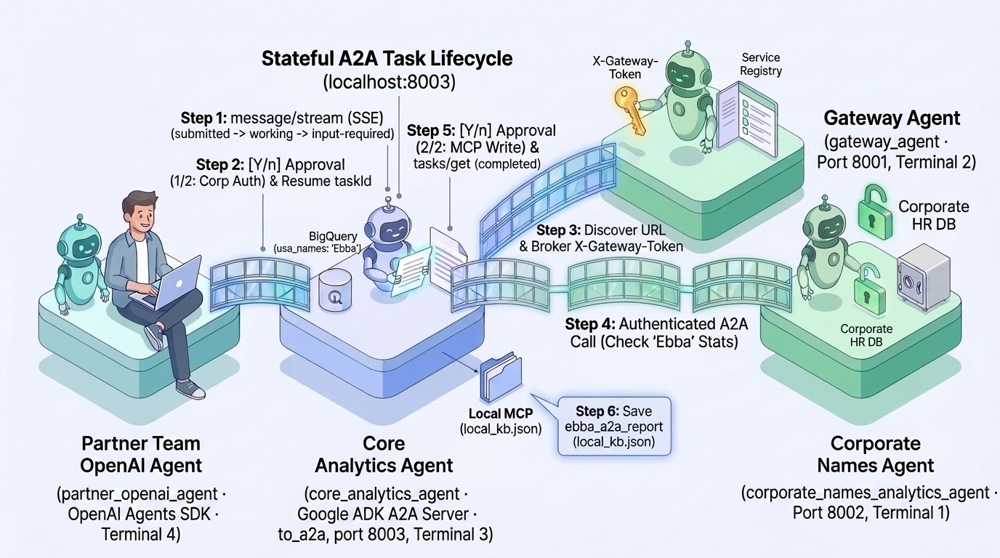

# From Solo Agents to Agent Ecosystems with A2A

Companion code repository for the technical blog post: **From Solo Agents to Agent Ecosystems with A2A** using **Gemini models on Gemini Agent Platform**.

---

## Architecture Overview

This repository implements a complete, **four-agent** enterprise analytics architecture across organizational teams, security boundaries, and agent SDKs:

1. **`core_analytics_agent` — Core Analytics Team (Google ADK Orchestrator & A2A Server on `:8003`):**
   * Queries public US Social Security Administration name demographics (`bigquery-public-data.usa_names.usa_1910_current`) via `analyze_name_in_bigquery`.
   * Reads and writes private workspace notes, analytics playbooks, and saved comparison reports in `local_kb.json` via **MCP** (`query_local_mcp_kb` and `write_local_mcp_kb`). No credentials or API keys are ever stored in `local_kb.json` or passed through the LLM prompt.
   * Authenticates out-of-band to `gateway_agent` using **Google Cloud OIDC / Application Default Credentials** (`GoogleCloudOIDCAuth(httpx.Auth)`), discovers remote A2A agents, and invokes them dynamically at runtime with `contact_discovered_a2a_agent`.
   * Exposed as a standards-compliant **A2A Server** in two lines of code via `to_a2a(root_agent, port=8003)` (`core_analytics_agent/adk_a2a_server.py`) so partner teams in other frameworks can delegate analytics workflows to it without duplicating its BigQuery, MCP, or Gateway auth tools.
2. **`partner_openai_agent` (`partner_openai_agent/openai_agent.py`) — Partner / Acquired Team (OpenAI Agents SDK Cross-Framework A2A Client):**
   * Represents a sister product or newly acquired partner team whose engineering stack is built on the **OpenAI Agents SDK** (`agents.Agent`), powered by a **Gemini model** (`OpenAIChatCompletionsModel`).
   * Instead of maintaining duplicate BigQuery SQL queries, MCP schemas, and Gateway token-brokering code across two teams, the Partner Team's OpenAI agent connects to `http://localhost:8003/.well-known/agent-card.json` and delegates the entire multi-step analytics workflow over the **stateful A2A Task Lifecycle** (`message/stream` SSE: `submitted` &rarr; `working` &rarr; `input-required` &rarr; `completed` + `tasks/get`) to the Core Analytics Team's Google ADK A2A Server.
3. **`gateway_agent` — Platform & Security Team (Remote Service Registry and OIDC-to-JWT Token Broker on `:8001`):**
   * Exposes both an **A2A Protocol** interface (`/.well-known/agent-card.json` + JSON-RPC 2.0 `message/send`) and legacy **REST API** endpoints (`/api/v1/lookup` and `/api/v1/token`) to demonstrate why semantic A2A discovery outperforms rigid REST schemas when internal service keys migrate (`corporate_names_analytics_agent` &rarr; `corp_analytics_registry` / `corporate_names_analytics_v2`).
   * Verifies the caller's out-of-band Google Cloud OIDC `Authorization: Bearer` token and mints a short-lived (5-minute TTL), cryptographically signed **HS256 JWT** (`X-Gateway-Token`) scoped to target audience `"corporate_names_analytics_v2"`.
4. **`corporate_names_analytics_agent` — HR & Corporate Systems Team (Protected Corporate Directory Agent on `:8002`):**
   * Owns a deterministic **5,000-Employee Corporate Directory** (`corp_employees`) backed by in-memory SQLite.
   * Enforces Zero-Trust HTTP middleware (`verify_gateway_jwt_and_rewrite_card`): cryptographically verifies the `X-Gateway-Token` JWT signature, issuer (`"gateway_agent"`), target audience (`"corporate_names_analytics_v2"`), and 5-minute expiration timestamp, rejecting unauthenticated or expired requests with `401 Unauthorized`.



---

## Repository Structure

```text
a2a-agent-ecosystem/
├── README.md                                  # Step-by-step A2A setup and testing guide
├── LICENSE                                    # Apache License, Version 2.0
├── pyproject.toml                             # Project metadata and dependencies for uv (Python 3.13)
├── .env.sample                                # Shared environment config template for all 4 agents
├── .python-version                            # Pins Python 3.13 for uv
├── .gitignore                                 # Ignores local .env files, .venv, and caches
├── docs/
│   └── diagrams/                              # Architecture diagrams referenced in this README
│       ├── a2a-four-agent-architecture.jpg
│       ├── rest-schema-limitations.jpg
│       ├── cross-framework-a2a-delegation.jpg
│       └── stateful-a2a-task-lifecycle.jpg
├── remote_agents/
│   ├── gateway_agent.py                       # Gateway Service Registry & Token Broker (:8001, A2A + REST comparison)
│   └── corporate_names_analytics_agent.py     # Protected 5,000-employee Corporate Directory A2A Agent (:8002)
├── core_analytics_agent/
│   ├── agent.py                               # Core Analytics Team's Google ADK Orchestrator (Agent + RemoteA2aAgent + OIDC Auth)
│   ├── tools.py                               # BigQuery SQL, Local MCP Read/Write, and Dynamic A2A Client
│   ├── utils.py                               # GoogleCloudOIDCAuth, retries, JWT masking, and A2A Task Lifecycle middleware
│   ├── instructions.py                        # Core Analytics Orchestrator system instructions
│   ├── local_kb.json                          # Local MCP knowledge base (playbooks, notes, saved reports)
│   └── adk_a2a_server.py                      # 2-line `to_a2a(root_agent, port=8003)` A2A Server wrapper
└── partner_openai_agent/
    ├── openai_agent.py                        # Partner Team's OpenAI Agents SDK Client (delegates over A2A to :8003)
    ├── openai_tools.py                        # OpenAI @function_tool A2A delegation wrappers (`call_core_analytics_a2a_agent`)
    └── openai_utils.py                        # Native OpenAI-compatible Gemini endpoint setup & stateful A2A Task Lifecycle client
```

---

## Prerequisites

1. **Google Cloud Project with Billing Enabled:**
   * A Google Cloud project with an active billing account linked (required for Gemini Agent Platform API calls and BigQuery public dataset queries).
   * Enable the required Google Cloud APIs in your project:
     ```bash
     gcloud services enable aiplatform.googleapis.com bigquery.googleapis.com --project="your-gcp-project-id"
     ```
2. **Clone the Repository & Install Dependencies (`Python 3.13` + [uv](https://docs.astral.sh/uv/)):**
   ```bash
   git clone https://github.com/pemujo/a2a-agent-ecosystem.git
   cd a2a-agent-ecosystem
   uv sync --python 3.13
   source .venv/bin/activate
   ```
3. **Google Cloud Authentication & `.env` Configuration:**
   * Authenticate with Application Default Credentials (ADC) and create your local `.env` file from `.env.sample`:
     ```bash
     gcloud auth application-default login
     cp .env.sample .env
     ```
   * **Important:** Open the newly created `.env` file in your editor and manually replace `"your-gcp-project-id"` with your actual Google Cloud Project ID (all four agents automatically load this root `.env` file on startup):
     ```dotenv
     GOOGLE_CLOUD_PROJECT="your-actual-gcp-project-id"
     ```

---

## Step-by-Step Guide to Running and Testing the Agents

### Step 1: Start the Protected Corporate Directory Agent (`corporate_names_analytics_agent` on `:8002`)

In **Terminal 1**, start the HR & Corporate Systems Team's Corporate Names Analytics Agent on port `8002`:

```bash
uv run uvicorn remote_agents.corporate_names_analytics_agent:a2a_app --host 127.0.0.1 --port 8002
```

#### What is happening in Step 1:
* **In-Memory Corporate HR Database:** On startup, `corporate_names_analytics_agent.py` initializes a deterministic 5,000-employee corporate directory in SQLite (`corp_employees`) containing employee names, departments, and office locations.
* **Public A2A Discovery (`/.well-known/agent-card.json`):** Wrapping the ADK agent with `to_a2a()` automatically publishes a machine-readable `AgentCard` at `http://localhost:8002/.well-known/agent-card.json` advertising its capability (`query_corporate_name_analytics`) while keeping its internal SQLite schema and prompts completely hidden.
* **Zero-Trust JWT Enforcement:** A Starlette HTTP middleware (`verify_gateway_jwt_and_rewrite_card`) intercepts every incoming `POST` request and verifies the `X-Gateway-Token` header using HMAC-SHA256—checking the token's cryptographic signature, issuer (`"gateway_agent"`), target audience (`"corporate_names_analytics_v2"`), and 5-minute expiration timestamp before allowing the request through.
  * Open **Terminal 2** and run these two `curl` commands to verify public discovery and Zero-Trust rejection against `:8002` (before starting the Gateway Agent in Terminal 2 in Step 2):
    ```bash
    # 1. Inspect the public Agent Card (200 OK):
    curl -s http://localhost:8002/.well-known/agent-card.json | python3 -m json.tool

    # 2. Attempt an unauthenticated A2A POST request without X-Gateway-Token (401 Unauthorized):
    curl -i -X POST http://localhost:8002/ \
      -H "Content-Type: application/json" \
      -d '{"jsonrpc":"2.0","id":"1","method":"message/send","params":{}}'
    ```

---

### Step 2: Start the Gateway Service Registry & Token Broker (`gateway_agent` on `:8001`)

In **Terminal 2** (keeping `corporate_names_analytics_agent` running in Terminal 1), start the Platform & Security Team's Gateway Agent on port `8001`:

```bash
uv run uvicorn remote_agents.gateway_agent:a2a_app --host 127.0.0.1 --port 8001
```

#### What is happening in Step 2:
* **Why Rigid REST Breaks vs. Semantic A2A Discovery:** `gateway_agent.py` exposes both legacy REST endpoints (`/api/v1/lookup` and `/api/v1/token`) and a semantic A2A endpoint (`http://localhost:8001/.well-known/agent-card.json`). Open **Terminal 3** and run the `curl` commands below to see how a rigid REST contract behaves when an internal service registry key migrates from `corporate_names_analytics_agent` to `corp_analytics_registry` (before starting `adk web` in Terminal 3 in Step 3):
  ```bash
  # 1. Exact internal registry key ('corp_analytics_registry') -> 200 OK:
  curl -i "http://localhost:8001/api/v1/lookup?service_key=corp_analytics_registry"

  # 2. Previous or natural service name ('corporate_names_analytics_agent') -> 400 Bad Request:
  curl -i "http://localhost:8001/api/v1/lookup?service_key=corporate_names_analytics_agent"
  ```
  Because `/api/v1/lookup` requires an exact string match on `service_key`, any caller still passing `corporate_names_analytics_agent` immediately breaks with `400 Bad Request`. By contrast, when an A2A client asks `gateway_agent` in natural language for the *"Corporate Names Analytics Agent"*, the Gateway's LLM semantically maps the request to `corp_analytics_registry` (`corporate_names_analytics_v2`) via `find_agent_by_service` and returns `http://localhost:8002` without breaking. You can verify this in **Terminal 3**:
  ```bash
  # 3. Semantic A2A lookup using the natural name ('corporate_names_analytics_agent') -> 200 OK:
  curl -s -X POST http://localhost:8001/ \
    -H "Content-Type: application/json" \
    -d '{
      "jsonrpc": "2.0",
      "id": "1",
      "method": "message/send",
      "params": {
        "message": {
          "role": "user",
          "messageId": "msg-1",
          "parts": [{"kind": "text", "text": "What is the URL for the corporate_names_analytics_agent service?"}]
        }
      }
    }' | python3 -m json.tool
  ```



* **Out-of-Band OIDC-to-JWT Token Exchange:** When an A2A client calls `gateway_agent`, the client's HTTP transport layer (`GoogleCloudOIDCAuth` in `utils.py`) automatically attaches the caller's Google Cloud OIDC `Authorization: Bearer` token. The Gateway middleware (`capture_auth_and_rewrite_card`) verifies the caller's identity out-of-band and allows `issue_access_token` to mint a short-lived (5-minute TTL), cryptographically signed **HS256 JWT** (`X-Gateway-Token`) scoped specifically to the Corporate Names Agent (`"corporate_names_analytics_v2"`).
  * **Production Secret Management Note:** Only `gateway_agent` (to sign) and `corporate_names_analytics_agent` (to verify) use `GATEWAY_JWT_SECRET`; calling agents never access the signing secret. For local convenience, `.env.sample` provides a default demo secret so both local servers work out of the box. In production deployments, inject `GATEWAY_JWT_SECRET` from a managed secret store such as Google Cloud Secret Manager (or use asymmetric RSA/ECDSA key pairs with a public JWKS endpoint).

---

### Step 3: Run the Core Analytics Team's Google ADK Orchestrator (`core_analytics_agent`)

In the same **Terminal 3** (with Terminals 1 and 2 running), launch the interactive Google ADK Web UI:

```bash
uv run adk web --port 8080 .
```

Open **`http://localhost:8080`** in your browser, select **`core_analytics_agent`** from the top-left dropdown, and try these two prompts:

1. **Test Zero-Trust Rejection First:**
   > *"Call `http://localhost:8002` directly without a token to get the top 5 corporate employee names."*
2. **Run the Full Multi-Agent Discovery, Token Brokering & Comparison Workflow:**
   > *"Compare the top 3 corporate employee names against the public US Names BigQuery dataset (discover the Corporate Names Agent URL and request a signed `X-Gateway-Token` JWT from the Gateway Agent first), and save a summary report under `adk_corp_vs_us_report` in `local_kb.json`."*
3. **Stop `adk web` When Finished Testing in the Browser:**
   Once you have verified both prompts and checked `core_analytics_agent/local_kb.json`, return to **Terminal 3** and press **`Ctrl+C`** to stop `adk web` (keep **Terminal 1** and **Terminal 2** running—in Step 4, you will run `core_analytics_agent` as a headless **A2A Server** on port `8003` instead of a web UI).

#### What is happening in Step 3:
1. **Prompt 1 (`401 Unauthorized`):** `core_analytics_agent` calls `contact_discovered_a2a_agent(agent_url="http://localhost:8002", access_token="")`. The Corporate Agent rejects the call with `401 Unauthorized`, proving that protected A2A agents cannot be queried without a valid Gateway-issued token.
2. **Prompt 2 (End-to-End A2A + BigQuery + MCP Flow):**
   * **A2A Hop 1 (Gateway Discovery & OIDC-to-JWT Exchange):** `core_analytics_agent` delegates to its `RemoteA2aAgent` sub-agent (`gateway_agent`). `get_gateway_httpx_client()` attaches your Google Cloud OIDC Bearer token in the HTTP header; `gateway_agent` resolves `http://localhost:8002` and mints a signed `X-Gateway-Token` JWT (which is automatically masked in terminal logs for security and cached in memory for the session).
   * **A2A Hop 2 (Authenticated Corporate Query):** `core_analytics_agent` invokes `contact_discovered_a2a_agent`, fetching `http://localhost:8002/.well-known/agent-card.json` and sending a JSON-RPC 2.0 `message/send` request with `X-Gateway-Token` in the HTTP header to retrieve the top corporate names (**Alex**, **Michael**, **David**).
   * **BigQuery Public Dataset Analytics:** For each corporate name, the agent calls `analyze_name_in_bigquery` to query `bigquery-public-data.usa_names.usa_1910_current` for historical US birth totals, peak popularity years, and top states.
   * **Local MCP Persistence:** Finally, the agent calls `write_local_mcp_kb` to persist the synthesized executive comparison report into `core_analytics_agent/local_kb.json`.

---

### Step 4: Expose the Core Analytics ADK Agent as an A2A Server (`to_a2a` on `:8003`) & Delegate from the Partner Team's OpenAI Agent

Now suppose a **Partner Team** whose engineering stack is built on the **OpenAI Agents SDK** (`partner_openai_agent/openai_agent.py`) wants to run this same public-versus-corporate demographic comparison. Instead of duplicating BigQuery SQL queries, MCP storage tools, and Gateway token-brokering logic inside their OpenAI codebase, the **Core Analytics Team** exposes `core_analytics_agent` as an **A2A Server** in two lines of code (`to_a2a(root_agent, port=8003)`), and the **Partner Team's OpenAI agent** delegates the entire workflow to `http://localhost:8003` over A2A!



1. **Start `core_analytics_agent` as an A2A Server (`:8003`):** After stopping `adk web` (`Ctrl+C`) in **Terminal 3** (while keeping `corporate_names_analytics_agent` on `:8002` in Terminal 1 and `gateway_agent` on `:8001` in Terminal 2 running), launch the Core Analytics Team's Google ADK A2A Server on port `8003`:
   ```bash
   uv run uvicorn core_analytics_agent.adk_a2a_server:a2a_app --host 127.0.0.1 --port 8003
   ```
2. Open a **Terminal 4** and start the Partner Team's OpenAI Agents SDK CLI:
   ```bash
   uv run python -m partner_openai_agent.openai_agent
   ```
3. At the `You >` prompt in Terminal 4, ask the Partner Team's OpenAI agent to run a cross-domain analysis via the Core Analytics A2A Server:
   > *"Analyze the name 'Ebba' in BigQuery, check 'Ebba' in the corporate directory via the Gateway Agent, and save a summary note under `ebba_a2a_report` in the analytics knowledge base!"*
4. Approve the two interactive **`[Y/n]`** human-in-the-loop permission prompts (`y` + `Enter`) as the task progresses.

#### What is happening in Step 4:



* **Native Gemini OpenAI-Compatible Endpoint:** `get_gemini_openai_model()` in `openai_utils.py` configures the Partner Team's OpenAI Agents SDK (`OpenAIChatCompletionsModel`) to talk directly to the Gemini OpenAI-compatible Chat Completions endpoint using Google Cloud Application Default Credentials (`_GoogleCloudADCAuth`).
* **Two-Line A2A Server (`to_a2a`):** `core_analytics_agent/adk_a2a_server.py` wraps the Core Analytics Team's Google ADK `root_agent` in `to_a2a(root_agent, port=8003)`, automatically generating `http://localhost:8003/.well-known/agent-card.json` and mounting JSON-RPC 2.0 streaming (`message/stream`), synchronous (`message/send`), and task-inspection (`tasks/get`) endpoints.
* **Cross-Framework Stateful A2A Task Lifecycle (`message/stream` SSE):**
  1. **Discovery & Streaming Submission (`submitted` &rarr; `working`):** The Partner Team's OpenAI client calls `call_core_analytics_a2a_agent`, fetches `http://localhost:8003/.well-known/agent-card.json`, and opens an SSE stream (`method: "message/stream"`).
  2. **Human-in-the-Loop Gate 1/2 (`input-required`):** Before the Core Analytics ADK server brokers a privileged `X-Gateway-Token` for the Corporate Directory on the Partner Team's behalf, the A2A Task pauses in `state='input-required'` (`tasks/get`) and prompts `[Confirm A2A Task ... (1/2)]`. When you confirm with `y`, the OpenAI client resumes the **exact same `taskId` and `contextId`**, and the ADK server queries BigQuery + the Gateway Agent + the Corporate Names Agent.
  3. **Human-in-the-Loop Gate 2/2 (`input-required` &rarr; `completed`):** Before modifying `local_kb.json`, the task pauses a second time in `state='input-required'` (`[Confirm A2A Task ... (2/2)]`). Approving with `y` resumes the task, writes `ebba_a2a_report` to `local_kb.json`, emits the final `analytics_report` artifact, transitions to `state='completed'`, and verifies the persisted task via `tasks/get`.

---

## License

Licensed under the [Apache License, Version 2.0](LICENSE).

## Disclaimer

This is a personal project and is not an official Google product. It is intended for demonstration and educational purposes only.
